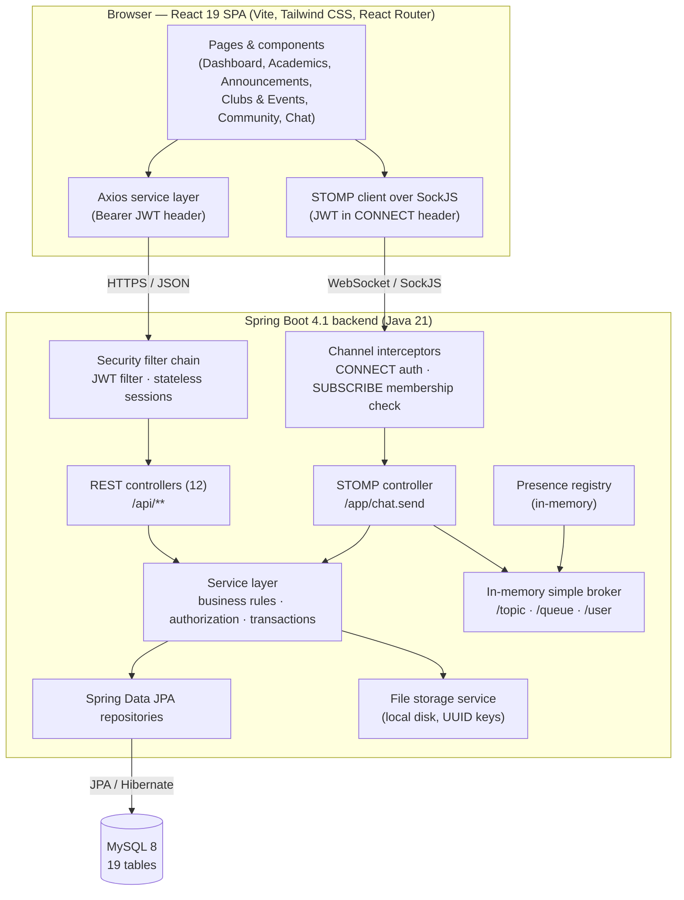
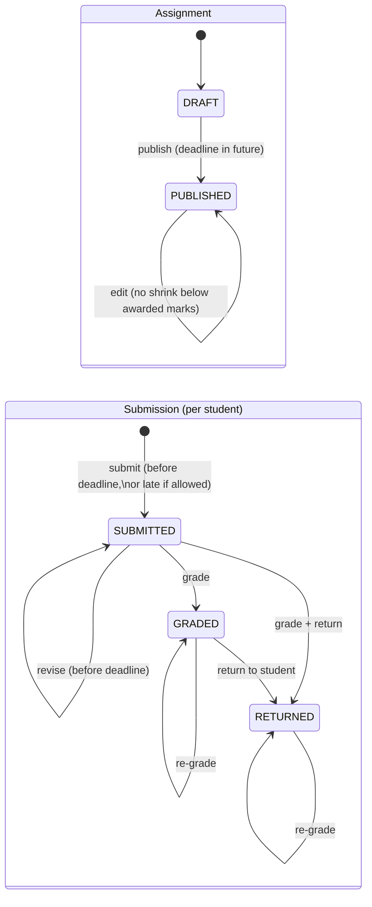
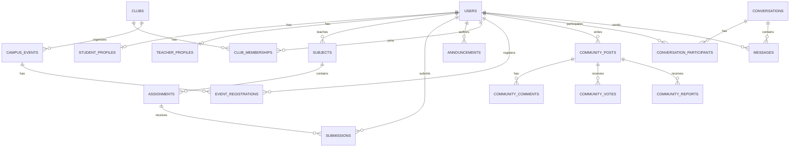
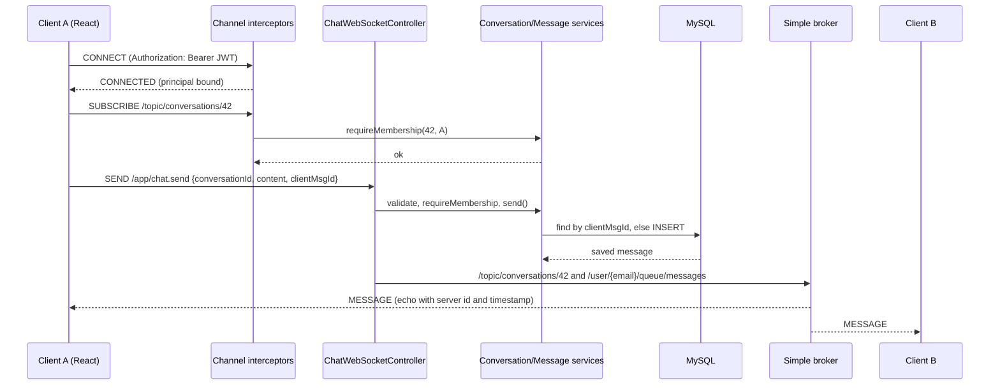

<!--
  IEEE-style conference paper draft (Markdown source).
  Two-column IEEE layout is not rendered by Markdown; to typeset, transfer the content into the
  IEEEtran LaTeX class (conference option) or the IEEE Word conference template.
  Items in [square brackets] must be completed or confirmed by the authors before submission.
-->

# CampusConnect: A Role-Based, Real-Time Web Platform for Unifying Academic Workflows and Campus Communication

**Aditya Gour, Aman Kumar Chauhan, Anjali Kumari, Aayushman Pathak, Akshat Verma**

Department of Computer Science & Engineering
Arya College of Engineering & I.T., Kukas, Jaipur, Rajasthan, India

Guided by Er. Ram Babu Buri, Department of Computer Science & Engineering

[Author e-mail addresses / corresponding author — to be supplied by the authors]

---

***Abstract*—Students and faculty in many colleges coordinate coursework, notices, club activities, and informal communication through a mix of learning platforms, messaging groups, notice boards, and paper. This fragmentation scatters information and leaves access control to whoever administers each channel. This paper presents CampusConnect, a full-stack web application that brings academic workflows (subjects, assignments, submissions, and grading), announcements, clubs and events, a moderated community board, and one-to-one real-time chat into a single platform for three roles: student, teacher, and administrator. The system is built as a layered modular monolith using React and Vite on the client, Spring Boot on Java 21 on the server, and MySQL for persistence. It uses stateless JSON Web Token (JWT) authentication for both REST and STOMP-over-WebSocket traffic. The paper focuses on the design decisions that keep this integration consistent and secure. These include centralized, server-side authorization that combines roles with ownership and audience matching, transaction-synchronized file storage, pessimistic locking for capacity-limited event registration, idempotent message delivery, and subscription-level authorization for real-time topics. The work is a software-engineering contribution, not a controlled experiment. The verification evidence reported here consists of 227 automated unit and controller tests across 26 test classes, all of which passed in the most recent recorded run. No performance, usability, or security-audit measurements have been made yet, so the paper specifies a reproducible evaluation protocol for that work and states the current limitations explicitly.*

***Index Terms*—Campus information systems, learning management systems, role-based access control, JSON Web Token, WebSocket, STOMP, Spring Boot, React, software architecture, academic workflow management.**

---

## I. Introduction

Higher-education institutions depend on two kinds of digital support. The first is structured academic administration: courses, assessments, deadlines, and grades. The second is less structured campus communication: announcements, extracurricular activity, peer discussion, and direct contact between students and teachers. Learning management systems (LMSs) address much of the first category [1], [2], and smart-campus initiatives aim to integrate institutional services more broadly [3]. In practice, however, many colleges still spread these functions across separate tools, such as an LMS or spreadsheet for coursework, instant-messaging groups for notices, physical notice boards for events, and personal messaging for queries. Each channel has its own membership model, and none gives the institution a consistent view of who may see or change what.

The educational value of communication is well established. Online interaction contributes to the social, cognitive, and teaching "presence" that supports learning [4], and a sense of classroom community can be described and measured [5]. These findings motivate placing communication features alongside academic workflows rather than leaving them on unmanaged channels.

CampusConnect is a web platform developed as a B.Tech. group project at Arya College of Engineering & I.T. It combines these functions in one application with one identity model. It is deliberately scoped as a single-institution system: registration currently accepts one configured college. The objective of this paper is to report the system's architecture and design decisions, the evidence available about its correctness, and the evaluation work that remains. The paper makes no claim of pedagogical impact or performance at scale.

The contributions of this paper are:

1. **An integrated, modular architecture** that delivers six functional modules (identity and profiles, academics, announcements, clubs and events, community, and chat/presence) through one REST API, one WebSocket endpoint, and one relational schema.
2. **A centralized authorization design for academic workflows** that combines coarse role checks with resource ownership and student-audience matching, derives identity only from the authenticated principal, and hides unauthorized resources by responding "not found."
3. **Consistency mechanisms for shared campus resources**, namely transaction-synchronized file storage, pessimistic row locking for event capacity, database-enforced uniqueness, and idempotent chat message delivery.
4. **An authenticated real-time channel** in which both the WebSocket handshake and each topic subscription are authorized.
5. **A transparent verification record and evaluation protocol** that separates what has been implemented, what has been tested, and what still needs to be measured.

The rest of the paper is organized as follows. Section II reviews related work. Section III states the research gap and objectives. Sections IV–VI describe the architecture, the design, and the implementation. Section VII discusses security, privacy, and ethics. Section VIII presents the evaluation evidence and protocol. Sections IX–XI cover the discussion, limitations, and conclusion.

## II. Related Work

### A. Learning Management and Course Management Systems

Watson and Watson distinguish learning management systems, which manage and track learning across an organization, from course management systems, which focus on delivering individual courses. They argue that the two terms are often used imprecisely [1]. Moodle is a widely studied open-source course management system. It was explicitly grounded in social-constructionist pedagogy and developed through participatory action research with its user community [2]. Such platforms provide mature assignment and grading workflows. Their scope, however, is usually the course: campus-wide announcements, student clubs, event registration, and informal peer discussion typically sit outside the course boundary or require separate plug-ins and administration.

### B. Digital and Smart Campus Platforms

Min-Allah and Alrashed survey the smart-campus concept and describe the integration of institutional services, infrastructure, and data as a central goal [3]. Their perspective covers a much broader scope than this project, including physical infrastructure and sensing. CampusConnect addresses a narrow, software-only slice of that vision: integrating the academic and social information services that students and teachers use every day.

### C. Online Community and Communication in Education

The Community of Inquiry framework identifies social, cognitive, and teaching presence as interdependent elements of an effective online educational experience [4]. Rovai developed and validated an instrument for measuring classroom community, operationalizing constructs such as connectedness and learning [5]. These works provide a theoretical reason to include discussion and messaging features in an academic platform, and they also supply candidate instruments for future evaluation (Section VIII). CampusConnect does not yet test any pedagogical hypothesis.

### D. Web Application Architecture

Representational State Transfer (REST) defines architectural constraints, including client–server separation, statelessness, and a uniform interface, that underpin resource-oriented web APIs [6]. Fowler's enterprise application patterns, including the layered architecture, service layer, and data transfer objects, describe how business logic is separated from presentation and persistence [7]. Microservice architectures break such systems into independently deployable services. They offer independent scaling and deployment, but they add distribution and operational complexity [8]. For a small team and a single institution, a modular monolith with clear internal boundaries is a defensible alternative, and Section IX discusses this trade-off.

### E. Access Control and Authentication

Role-based access control (RBAC) assigns permissions to roles rather than to individual users [9], and the NIST RBAC model standardizes its core components and functions [10]. Pure RBAC cannot express rules such as "a teacher may grade only submissions for subjects that teacher teaches," which depend on relationships between users and resources. Broken access control is ranked first in the OWASP Top 10:2025, which recommends enforcing authorization in trusted server-side code, denying access by default, and checking ownership of records [11]. JSON Web Tokens (JWTs) provide a compact, signed format for conveying claims between parties [12]. The bcrypt adaptive password-hashing function makes the cost of password hashing tunable as hardware improves [13].

### F. Real-Time Web Communication

The WebSocket protocol provides full-duplex communication over a single TCP connection that begins as an HTTP upgrade [14]. STOMP is a simple text-based messaging protocol that adds destinations, subscriptions, and message frames, and it is commonly layered on top of WebSocket [15]. The Spring Framework supports STOMP over WebSocket, including an in-memory "simple broker," user-specific destinations, and channel interceptors [16]. Note that the WebSocket handshake and STOMP subscriptions bypass the per-request filters that protect REST endpoints. Applications therefore need to authorize these paths separately, and Section VI-D describes how CampusConnect does so.

## III. Research Gap and Objectives

The literature and tools above offer mature solutions to the individual sub-problems: course management [1], [2], access-control models [9], [10], and real-time messaging protocols [14], [15]. The gap this project addresses is not a missing algorithm. It is the engineering problem of integrating these sub-problems into one coherent, small-footprint platform without losing consistent authorization, data integrity, or transparency about what has been verified. In particular, when academic records, community content, event capacity, and private messages share one identity model, a single authorization mistake can expose data across modules. The design therefore has to make authorization and consistency rules explicit, central, and testable.

The project objectives are:

- **O1:** Provide one identity and profile model for students, teachers, and administrators, with administrator privileges granted only through trusted server-side configuration.
- **O2:** Support the complete assignment lifecycle (subject definition, drafting, publication, submission, revision, grading, and return), with deadlines and visibility enforced on the server.
- **O3:** Provide audience-aware announcements, club membership, and capacity-limited event registration that remain correct under concurrent requests.
- **O4:** Provide a moderated community board and authenticated one-to-one real-time chat with online/offline presence.
- **O5:** Enforce authorization in server-side code for every REST and WebSocket path, consistent with OWASP guidance [11].
- **O6:** Back the implementation with automated tests and define a reproducible protocol for the performance, usability, and security evaluation that has not yet been done.

## IV. Proposed System Architecture

### A. Overview

CampusConnect follows a client–server architecture with a layered backend (Fig. 1). The React single-page application (SPA) communicates with the backend over two channels. The first is a JSON REST API under `/api/**`. The second is a STOMP-over-WebSocket endpoint at `/ws/sockjs`, which uses SockJS as a transport fallback. In production, a multi-stage Docker build compiles the SPA and packages it as static resources inside the Spring Boot executable. One container therefore serves both the website and the API from the same origin.

*Fig. 1. Implemented CampusConnect architecture. All components shown exist in the repository; component counts were obtained by inspecting the source code.*

### B. Backend Layers

The backend uses the base package `com.campusconnect` and follows the conventions documented in the project. Controllers handle HTTP mapping and validation. Services hold business rules and transaction boundaries. Repositories wrap Spring Data JPA. Controllers exchange data transfer objects (DTOs) rather than JPA entities, which keeps the persistence model out of the API contract [7]. The current codebase contains 12 REST controllers exposing 67 handler methods, one STOMP message controller, and 19 JPA entities, each mapped to its own table. A global exception handler (`@RestControllerAdvice`) converts domain exceptions into a uniform JSON error body with status codes 400, 401, 403, 404, 409, 413, or 500. For unexpected failures it returns a generic message so that internal details are not exposed to clients.

### C. Functional Modules

Table I summarizes the modules and their API surface.

*TABLE I. Implemented modules and REST surface*

| Module | Base path(s) | Handler methods | Principal responsibilities |
|---|---|---|---|
| Identity & profiles | `/api/auth`, `/api/profile` | 4 | Registration (student/teacher), login, profile view/update |
| Academics | `/api/subjects`, `/api/assignments`, `/api/submissions` | 22 | Subjects, assignment lifecycle, attachments, submissions, grading, rosters |
| Announcements | `/api/announcements` | 5 | Audience- and department-filtered notices, pinning |
| Clubs & events | `/api/clubs`, `/api/events` | 17 | Club discovery/membership, event CRUD, registration, attendee lists |
| Community | `/api/community` | 12 | Posts, upvotes, comments, reports, moderation queue, audit log |
| Chat & presence | `/api/conversations`, `/api/presence`, STOMP `/app/chat.send` | 7 (+1 STOMP) | One-to-one conversations, message history/sending, online status |

### D. Frontend Architecture

The client is built with React 19, React Router, Vite, and Tailwind CSS 4. Authenticated pages are lazy-loaded into separate bundles and rendered inside a shared dashboard layout with a sidebar, a mobile drawer, and a light/dark theme. Route guards (`ProtectedRoute`, `PublicOnlyRoute`, and `RequireRole`) control navigation. These guards are a usability convenience, not a security boundary, because all authorization is enforced on the server (Section V-B). A shared Axios instance attaches the bearer token and broadcasts an application-level "unauthorized" event when it receives HTTP 401, which clears the client session.

## V. System Design and Methodology

### A. Development Methodology

The team of five built the system incrementally, with each member owning one or two modules (Section XI lists the contributions). Work followed a feature-branch workflow with pull requests into a protected `main` branch. The repository history contains 76 commits, including merges of 21 numbered pull requests. Shared files such as the build descriptors, the security configuration, and the schema were changed only after team agreement, following the project's contribution rules. The integration order was authentication and profiles, then the dashboard shell, then chat, community, announcements, academics, and clubs and events, followed by security and performance fixes and containerized deployment.

### B. Authorization Model

Authorization is layered, combining the role-based model [9], [10] with relationship-based checks that pure RBAC cannot express:

1. **Authentication gate.** In the Spring Security filter chain, every `/api/**` route except `/api/auth/**` requires an authenticated principal. Requests without one receive a JSON 401 response.
2. **Coarse role checks.** Seventeen method-level `@PreAuthorize` annotations in the academics and announcements controllers restrict operations by role. For example, only teachers may create or grade assignments, only students may submit, and only teachers and administrators may post announcements.
3. **Ownership and audience checks.** A dedicated `AcademicAccessService` centralizes the academic rules. Administrators may view all subjects, assignments, and submissions, and may create or update subjects, but they do not edit, publish, delete, or grade assignments. A teacher may manage only subjects whose `teacher_id` matches their own identity. A student may see a subject only if their profile matches its audience: the same department, plus year, course, and section wherever the subject specifies them. Students see only published assignments. The other modules apply equivalent checks inside their services. Only post or comment authors and administrators may delete community content. Only club coordinators, leads, or administrators may manage club events. Only conversation participants may read or send messages.
4. **Identity from the principal only.** Services resolve the acting user from the authenticated principal's e-mail address. User or owner identifiers supplied in request bodies are never trusted for authorization.
5. **Concealment.** When a user is not allowed to see an academic resource, the service responds "404 Not Found" rather than "403 Forbidden," so the existence of the resource is not revealed.

### C. Academic Workflow Design

Assignments and submissions are modeled as state machines (Fig. 2) with these invariants:

- New assignments are drafts unless they are published at creation. Publication is one-way and requires a future deadline.
- Maximum marks cannot be reduced below marks already awarded. An assignment that has submissions cannot be deleted or moved to another subject.
- Each student submits at most once per assignment. The service checks this and a database unique constraint on (`assignment_id`, `student_id`) enforces it.
- After the deadline, a first submission is rejected unless the assignment allows late work, in which case it is accepted and flagged as late. A student may revise a submission only before the deadline and only while it is still ungraded.
- Marks must lie between 0 and the maximum. Grades stay hidden from the student until the teacher returns the work, and returned work cannot be "un-returned."

*Fig. 2. Assignment and submission lifecycles as enforced by `AssignmentService` and `SubmissionService`.*

For teachers, the submissions view is a full roster rather than a list of submissions. It joins every eligible student, determined by the same audience rule used for visibility, with any submission they have made. This lets teachers see who has *not* submitted and filter by pending, submitted, graded, or late. Assignment lists compute per-assignment statistics in batched queries, so the number of queries per list is fixed rather than growing with the number of assignments.

### D. Consistency Mechanisms

Several features modify shared state that concurrent requests can contend for. The design handles each case explicitly:

- **Event capacity.** Registration loads the event row with a JPA `PESSIMISTIC_WRITE` lock (`SELECT … FOR UPDATE`) before checking the status, end time, registration deadline, and remaining capacity, and before incrementing the registered count. This serializes concurrent registrations for the same event and prevents overbooking, which is a standard application of lock-based concurrency control [17]. A unique constraint on (`event_id`, `user_id`) also prevents duplicate registrations.
- **Idempotent messaging.** Each chat message carries a client-generated UUID (`clientMsgId`). Before inserting a message, the server returns any existing message with the same identifier, and a unique constraint on `client_msg_id` backs this check. As a result, retries after a reconnect or a duplicated submission over REST do not create duplicate messages. This mirrors the HTTP notion of idempotent requests, which can be repeated safely [18].
- **Votes and reports.** Unique constraints on (`post_id`, `user_id`) allow at most one upvote and one report per user per post. The same rule applies to club memberships.
- **File storage tied to transactions.** Uploaded files are written to disk under a random UUID name. If the surrounding database transaction rolls back, the file is deleted. Replaced files are deleted only after the transaction commits. This prevents both orphaned files and dangling references.

### E. Data Model

Fig. 3 shows the core entities and their relationships. User profiles are split into a `users` table and role-specific `student_profiles` and `teacher_profiles` tables, each linked one-to-one and carrying unique enrollment-number or employee-ID constraints. File metadata (original name, storage key, content type, and size) is stored as an embedded value object inside assignments and submissions.

*Fig. 3. Core entity relationships (simplified; attributes omitted). The `moderation_audit_logs` table records moderator actions by e-mail and target identifier and has no foreign-key relationship.*

## VI. Implementation Details

### A. Technology Stack

*TABLE II. Technology stack (versions from `pom.xml` and `package.json`)*

| Layer | Technologies |
|---|---|
| Frontend | React 19.3, React Router 8, Vite 8, Tailwind CSS 4.3, Axios, `@stomp/stompjs` 7, `sockjs-client`, Lucide icons |
| Backend | Java 21, Spring Boot 4.1 (Web MVC, Data JPA, Security, Validation, WebSocket), jjwt 0.12.6, Maven |
| Persistence | MySQL 8 via Hibernate; HikariCP connection pool |
| Testing | JUnit 5, Mockito, Spring MockMvc (standalone mode) |
| Deployment | Multi-stage Docker image (Node 22 build → Maven/Temurin 21 build → Temurin 21 JRE runtime) |

These technologies were chosen for familiarity within the team, mature documentation, and first-class support for the required features: declarative security, JPA locking, and STOMP messaging in Spring, and component-based UI with code splitting in React. The trade-offs, such as the operational limits of an in-memory broker, are discussed in Section IX.

### B. Authentication

Registration accepts only the `STUDENT` and `TEACHER` roles and explicitly rejects `ADMIN`. It requires a unique enrollment number for students or employee ID for teachers, and it requires the configured college. Passwords are hashed with Spring Security's `BCryptPasswordEncoder` [13]. On successful registration or login, the server issues an HMAC-signed JWT [12] whose subject is the user's e-mail address and which includes role and user-ID claims. The default lifetime is 24 hours and can be configured. The signing secret has no default, so the application refuses to start unless `JWT_SECRET` is provided. Administrator accounts are created or promoted at startup by a provisioning component, and only when the server-side variable `ADMIN_PROVISION_EMAIL` is set. If the account already exists, its password is never overwritten.

On each request, a `OncePerRequestFilter` validates the bearer token's signature and expiry and loads the current user from the database. Role changes and account deletions therefore take effect immediately rather than when the token expires. Sessions are stateless and HTTP Basic and form login are disabled. CSRF protection is disabled, which is conventional for APIs authenticated by an `Authorization` header rather than by cookies.

### C. Academics Module

The academics implementation follows the design in Section V-C. Rules are centralized in services, and `AcademicAccessService` acts as the single policy point for the module. Attachments and submission files are stored outside the web root under generated names of the form `<uuid>.<ext>`. Extensions are checked against a configurable allow-list (PDF, office documents, text, CSV, ZIP, and common images), and the response content type is derived from the extension rather than taken from the client. User-supplied file names are sanitized and never influence the storage path. Storage keys must match a strict pattern and resolve directly inside the storage root, which blocks path traversal. File size is limited to 10 MB by default.

### D. Real-Time Chat and Presence

Fig. 4 shows the message path. On STOMP `CONNECT`, an inbound channel interceptor validates the JWT from the native `Authorization` header and attaches the principal to the session. A second interceptor checks every `SUBSCRIBE` to `/topic/conversations/{id}` and rejects it unless the principal is a participant in that conversation, which prevents eavesdropping by guessing identifiers. The `/app/chat.send` handler re-validates the payload, because STOMP handlers do not run bean validation. It checks for empty content, a missing `clientMsgId`, and content longer than 4,000 characters, then verifies membership and persists the message idempotently. The saved message is broadcast to the conversation topic and to each participant's user queue. Errors go to the sender's private `/user/queue/errors` destination, so the connection is not dropped.

*Fig. 4. Authenticated chat message flow as implemented.*

On the client, the STOMP client reconnects automatically after 5 seconds. When no live connection is available, it falls back to a REST send endpoint that uses the same `clientMsgId`, so deduplication covers both paths. Presence is tracked in memory as a set of active WebSocket session IDs per user. A user counts as online while at least one session is open, and transitions to online or offline are broadcast on `/topic/presence`.

### E. Announcements, Clubs and Events, and Community

Announcements carry a category, a free-text audience, an optional department, and a pinned flag. Repository queries filter them by role. Students never receive announcements addressed only to teachers or faculty, and they otherwise see announcements for everyone, for students, or for their own department. Teachers and administrators may post, but teachers may edit or delete only their own announcements.

Clubs have categories, unique names and slugs, and memberships with three roles: member, coordinator, and lead. Joining is currently approved automatically. Events support capacity limits, registration deadlines, online or offline venues, and a featured flag that only administrators may change when an event is updated. They are listed with pagination as upcoming or past and filtered by category and search terms. On first start, a seeder fills an empty database with a directory of the institution's clubs and sample events. Sample records carry a `sampleData` flag so the interface can tell them apart from real data.

The community board supports categorized posts, toggled upvotes, comments, and one report per user per post. Posts in the "facilities" category become feedback items whose status may be updated by the author or by staff. Administrators have a reported-content queue, can resolve reports, and can delete any post or comment. Each moderator action on another user's content is recorded in `moderation_audit_logs`. Post lists load votes, reports, comments, and author departments in batches to avoid the "N+1 query" problem.

### F. Configuration and Deployment

All environment-specific values come from environment variables, with a local `.env` loader for development. These include database credentials, the JWT secret and lifetime, CORS origins, file-storage limits, and admin provisioning. A separate `prod` profile deliberately has no fallback for database credentials or the JWT secret, so a misconfigured deployment fails at startup rather than silently connecting to defaults. It also honors the platform `PORT` variable and forwarded headers when running behind an HTTPS proxy. Hibernate manages the schema with `ddl-auto=update`, and `database/schema.sql` documents 14 of the 19 tables. The five community tables are created by Hibernate alone.

## VII. Security, Privacy, and Ethical Considerations

**Implemented controls.** The controls verified in the code are:

- BCrypt password hashing [13].
- Signed, expiring JWTs with a mandatory external secret [12].
- Server-side authorization on every REST and WebSocket path, following OWASP recommendations [11].
- Concealment of unauthorized academic resources.
- No public administrator registration.
- File allow-listing, size limits, generated storage names, and path-traversal checks.
- Generic error messages for unexpected failures.
- Fail-fast production configuration.

**Known weaknesses.** Several gaps found during code inspection should be read alongside these controls:

1. The JWT is stored in browser `localStorage`. OWASP advises against keeping session identifiers in web storage, because any cross-site scripting flaw can read them [19]. HTTP-only, `SameSite` cookies combined with CSRF protection would reduce this exposure.
2. There is no token revocation or refresh mechanism, so a stolen token remains valid until it expires (24 hours by default).
3. Login and registration have no rate limiting or lockout, and e-mail addresses are not verified.
4. Teacher self-registration requires an employee ID, but nothing checks that ID against an institutional record. Any user could therefore register with the teacher role. Institutional verification or administrator approval of teacher accounts is required before real-world use.
5. The WebSocket endpoint always adds `localhost` origin patterns to its allow-list, including in production. This is low risk, but it should be restricted by profile.
6. Uploaded files are not scanned for malware.

**Privacy and ethics.** The system processes personal data, including names, e-mail addresses, enrollment numbers, phone numbers, grades, and private messages. Before any deployment beyond a classroom demonstration, the institution should define data retention and deletion policies and should limit administrative access to private messages (none is currently exposed through the API). It should also inform users how moderation logs are used and confirm compliance with applicable data-protection law. The community board's moderation tools give administrators considerable power over student speech, so transparent moderation guidelines are an ethical prerequisite as well as a technical one.

## VIII. Evaluation Methodology and Results

### A. Available Evidence: Automated Tests

The backend contains 26 test classes with 227 test methods, all written with JUnit 5 and Mockito. Controller tests use MockMvc in standalone mode together with the production exception handler, so they check request mapping, status codes, and error bodies. Service tests check business and authorization rules against mocked repositories. Table III summarizes the per-module counts, which come from the Maven Surefire reports produced by the most recent recorded test run (11 Oct 2026, 15:49–15:50 IST, on a developer machine).

*TABLE III. Automated test inventory and most recent recorded outcome*

| Module | Test classes | Tests | Failures / errors / skipped |
|---|---|---|---|
| Identity, profiles, JWT | 5 | 25 | 0 / 0 / 0 |
| Academics (subjects, assignments, submissions, access, file storage) | 8 | 104 | 0 / 0 / 0 |
| Announcements | 2 | 22 | 0 / 0 / 0 |
| Clubs & events | 2 | 15 | 0 / 0 / 0 |
| Community | 2 | 17 | 0 / 0 / 0 |
| Chat, presence, subscription authorization | 7 | 44 | 0 / 0 / 0 |
| **Total** | **26** | **227** | **0 / 0 / 0** |

**Interpretation and caveats.** These results show that the specified business and authorization rules behave as intended when components are isolated. Examples include rejecting a late first submission, refusing to let a teacher grade another teacher's submission, rejecting conversation subscriptions from non-participants, and enforcing mark bounds. The results do *not* show correct behavior against a real MySQL instance, because no test starts the application context, a database, or a message broker. Two commits followed the recorded run. They changed only deployment configuration (the Dockerfile, the static-resource configuration for the bundled SPA, the production properties, one security-matcher adjustment for non-API paths, and the ordering of the admin provisioning runner), not the service or controller logic under test. The suite was not re-executed while preparing this paper. The frontend has no automated tests. Code coverage has not been measured.

### B. Not Yet Measured

This paper reports **no** measurements of response time, throughput, real-time message latency, concurrency behavior against a live database, usability, accessibility, or security-audit outcomes. **No** user study has been conducted.

### C. Proposed Evaluation Protocol

The following protocol is proposed so that future work can be reproduced. It is organized by the ISO/IEC 25010:2023 product-quality characteristics [20].

1. **Functional suitability (integration).** Add Spring Boot integration tests that run against a disposable MySQL 8 instance, for example in a container. Cover the full assignment lifecycle (Fig. 2) and every role transition in Table I. *Metric:* pass rate per requirement, plus traceability from each SRS functional requirement to at least one test.
2. **Security (authorization matrix).** For each of the 67 REST handlers and the STOMP destinations, run automated requests as an anonymous user, a student, the owning teacher, a non-owning teacher, and an administrator. *Metric:* the number of responses that deviate from the documented policy. The release criterion is zero. Supplement this with dependency vulnerability scanning and a dynamic scan of the deployed container.
3. **Reliability (concurrency).** Fire *N* simultaneous registration requests (for example, *N* = 100) at an event with capacity *k* < *N*, repeated over at least 30 trials. *Metric:* the number of runs in which confirmed registrations exceed *k* (expected: zero). Separately, replay chat messages with duplicate `clientMsgId` values across reconnects and count duplicates that persist (expected: zero).
4. **Performance efficiency.** Load-test representative read and write endpoints, such as assignment lists, community feeds, and submissions, at increasing numbers of virtual users on fixed, documented hardware. *Metrics:* median and 95th-percentile latency, throughput, and error rate. For chat, measure send-to-receive latency between two clients by comparing client timestamps against a synchronized clock.
5. **Interaction capability (usability).** Run task-based sessions with students and teachers recruited from the institution under informed consent. Example tasks include submitting an assignment, grading a submission, registering for an event, and starting a chat. Record task completion rate and time on task, and administer the System Usability Scale (SUS) after the sessions [21]. A classroom-community instrument [5] could be added in a longitudinal pilot, but any claim about community or learning outcomes needs a comparison condition and ethical approval.

Results should be reported with sample sizes, environment details, and confidence intervals where the sample size allows.

## IX. Discussion

**Modular monolith versus microservices.** CampusConnect deploys as a single unit. For a five-person team serving a single institution, this avoids network partitions between services, distributed transactions, and the overhead of operating many services, all of which are characteristic costs of microservices [8]. Because the modules share one database, the system can rely on local ACID transactions, row locks, and unique constraints (Section V-D). A distributed design would need sagas or idempotent compensation to achieve the same guarantees. The cost is coupled deployment and scaling. More specifically, the in-memory STOMP broker and in-memory presence registry tie real-time features to a single instance. Scaling out horizontally would require an external broker relay and shared presence storage.

**Centralizing authorization.** Placing the academic policy in one service, rather than scattering checks across controllers, made the rules reviewable and directly unit-testable. The access-control tests exercise this policy in isolation. The layered approach (role annotations at the controller boundary, relationship checks in services, and database constraints as a last line of defense) follows the OWASP recommendation to enforce access control in trusted server code and to deny by default [11]. In other modules, however, ownership checks are implemented locally in each service. A shared policy abstraction would reduce the risk of inconsistency as the system grows.

**Integration as a source of risk.** Combining private messaging, grades, and public community content in one identity model increases the impact of any authorization defect. This is why Section VIII proposes a systematic authorization matrix as the first security evaluation, rather than relying on unit tests of individual rules.

**Honest scope.** Not all user-facing surfaces are connected to live data yet. The role-specific dashboard widgets for assignments, deadlines, pending reviews, events, activity, and administrator statistics currently use labeled mock data, and only announcements are fetched live. The dedicated module pages (Academics, Announcements, Clubs & Events, and Chat) use the live API throughout.

## X. Limitations and Future Work

**Limitations.** The current system has the following limitations:

- **Evaluation.** There are no performance, usability, or security-audit measurements, no integration or frontend tests, and no coverage data (Section VIII).
- **Security.** Tokens are stored in `localStorage`, there is no token revocation, no rate limiting, no e-mail verification, and teacher accounts are unverified (Section VII).
- **Scalability.** The in-memory broker and presence registry, together with local-disk file storage, confine real-time features and file handling to a single instance.
- **Functionality.** Dashboards partly use mock data. Chat is limited to one-to-one conversations. Unread counts are tracked only on the client during a session (the server always reports zero). There are no notifications. Club joining has no approval step. Announcement audiences are free-text values rather than a controlled vocabulary. Registration is restricted to one institution.
- **Data management.** The schema is maintained by Hibernate's `update` mode rather than by versioned migrations, and `schema.sql` does not yet cover the community tables.

**Future work.** The following items follow directly from these limitations:

1. Run the evaluation protocol in Section VIII-C and publish the results.
2. Move tokens to HTTP-only cookies with refresh-token rotation, and add rate limiting, e-mail verification, and administrator approval of teacher accounts.
3. Connect the dashboards to live aggregate endpoints, and add persistent unread counts and in-app and e-mail notifications.
4. Add versioned schema migrations and integration tests against MySQL.
5. Introduce an external STOMP broker relay and shared presence storage to support multiple instances, and object storage for files.
6. Generalize the single-college constraint into multi-institution tenancy with per-tenant data isolation.

## XI. Conclusion

This paper presented CampusConnect, a role-based web platform that integrates academic workflows, announcements, clubs and events, a moderated community board, and real-time chat for students, teachers, and administrators. Its main engineering contributions are a centralized, relationship-aware authorization design; explicit consistency mechanisms for shared resources (pessimistic locking, unique constraints, idempotent messaging, and transaction-synchronized file storage); and an authenticated real-time channel that authorizes both the connection and each subscription. The implementation is supported by 227 passing automated unit and controller tests. It has not yet been evaluated for performance, usability, or security in a deployed setting, and the paper has specified a reproducible protocol for doing so. CampusConnect should therefore be regarded as a working, unit-tested prototype whose institutional value remains to be established empirically.

## Acknowledgment

The authors thank Er. Ram Babu Buri, Department of Computer Science & Engineering, Arya College of Engineering & I.T., for his guidance throughout the project.

**Author contributions.** A. Gour: project setup, landing page, role-based dashboard, academics page, security and performance fixes, college registration flow, and Docker deployment. A. K. Chauhan: authentication, user profiles, shared database and deployment settings, UML diagrams, and the SRS. A. Kumari: announcements module. A. Pathak: chat, presence, the community and feedback hub, and the clubs and events module. A. Verma: academics backend (subjects, assignments, and submissions).

## References

[1] W. R. Watson and S. L. Watson, "An argument for clarity: What are learning management systems, what are they not, and what should they become?" *TechTrends*, vol. 51, no. 2, pp. 28–34, Mar. 2007, doi: 10.1007/s11528-007-0023-y.

[2] M. Dougiamas and P. C. Taylor, "Moodle: Using learning communities to create an open source course management system," in *Proc. EdMedia 2003—World Conf. Educational Multimedia, Hypermedia & Telecommunications*, Honolulu, HI, USA, 2003, pp. 171–178.

[3] N. Min-Allah and S. Alrashed, "Smart campus—A sketch," *Sustainable Cities and Society*, vol. 59, Art. no. 102231, Aug. 2020, doi: 10.1016/j.scs.2020.102231.

[4] D. R. Garrison, T. Anderson, and W. Archer, "Critical inquiry in a text-based environment: Computer conferencing in higher education," *The Internet and Higher Education*, vol. 2, no. 2–3, pp. 87–105, 1999, doi: 10.1016/S1096-7516(00)00016-6.

[5] A. P. Rovai, "Development of an instrument to measure classroom community," *The Internet and Higher Education*, vol. 5, no. 3, pp. 197–211, 2002, doi: 10.1016/S1096-7516(02)00102-1.

[6] R. T. Fielding, "Architectural styles and the design of network-based software architectures," Ph.D. dissertation, Dept. Inf. Comput. Sci., Univ. California, Irvine, CA, USA, 2000.

[7] M. Fowler, *Patterns of Enterprise Application Architecture*. Boston, MA, USA: Addison-Wesley, 2002.

[8] N. Dragoni, S. Giallorenzo, A. L. Lafuente, M. Mazzara, F. Montesi, R. Mustafin, and L. Safina, "Microservices: Yesterday, today, and tomorrow," in *Present and Ulterior Software Engineering*, M. Mazzara and B. Meyer, Eds. Cham, Switzerland: Springer, 2017, pp. 195–216, doi: 10.1007/978-3-319-67425-4_12.

[9] R. S. Sandhu, E. J. Coyne, H. L. Feinstein, and C. E. Youman, "Role-based access control models," *Computer*, vol. 29, no. 2, pp. 38–47, 1996, doi: 10.1109/2.485845.

[10] D. F. Ferraiolo, R. Sandhu, S. Gavrila, D. R. Kuhn, and R. Chandramouli, "Proposed NIST standard for role-based access control," *ACM Trans. Inf. Syst. Secur.*, vol. 4, no. 3, pp. 224–274, Aug. 2001, doi: 10.1145/501978.501980.

[11] OWASP Foundation, "OWASP Top 10:2025—A01:2025 Broken Access Control," 2025. [Online]. Available: https://owasp.org/Top10/2025/ (accessed Oct. 12, 2026).

[12] M. Jones, J. Bradley, and N. Sakimura, "JSON Web Token (JWT)," RFC 7519, IETF, May 2015, doi: 10.17487/RFC7519.

[13] N. Provos and D. Mazières, "A future-adaptable password scheme," in *Proc. USENIX Annu. Tech. Conf. (FREENIX Track)*, 1999. [Online]. Available: https://www.usenix.org/legacy/events/usenix99/provos.html

[14] I. Fette and A. Melnikov, "The WebSocket protocol," RFC 6455, IETF, Dec. 2011, doi: 10.17487/RFC6455.

[15] "STOMP protocol specification, version 1.2." [Online]. Available: https://stomp.github.io/stomp-specification-1.2.html (accessed Oct. 12, 2026).

[16] Spring Framework Reference Documentation, "WebSockets: STOMP." [Online]. Available: https://docs.spring.io/spring-framework/reference/web/websocket/stomp.html (accessed Oct. 12, 2026).

[17] P. A. Bernstein, V. Hadzilacos, and N. Goodman, *Concurrency Control and Recovery in Database Systems*. Reading, MA, USA: Addison-Wesley, 1987.

[18] R. Fielding, M. Nottingham, and J. Reschke, Eds., "HTTP semantics," RFC 9110, IETF, Jun. 2022, doi: 10.17487/RFC9110.

[19] OWASP Cheat Sheet Series, "HTML5 security cheat sheet—Local storage." [Online]. Available: https://cheatsheetseries.owasp.org/cheatsheets/HTML5_Security_Cheat_Sheet.html (accessed Oct. 12, 2026).

[20] *Systems and Software Engineering—Systems and Software Quality Requirements and Evaluation (SQuaRE)—Product Quality Model*, ISO/IEC 25010:2023, Nov. 2023.

[21] J. Brooke, "SUS: A 'quick and dirty' usability scale," in *Usability Evaluation in Industry*, P. W. Jordan, B. Thomas, B. A. Weerdmeester, and I. L. McClelland, Eds. London, U.K.: Taylor & Francis, 1996, pp. 189–194.
